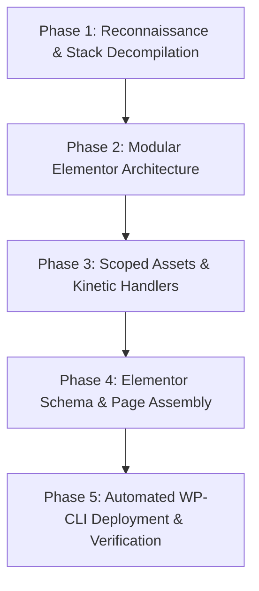

# Decoupling & Conversion Strategy: From External Codebases to Native WordPress & Elementor

> **Document Type:** Production Engineering Architectural Blueprint  
> **Target Audience:** WordPress Core Engineers, Full-Stack Developers, Theme & Plugin Architects  
> **Source Case Study:** Travel & LIV Collective ([https://travelnliv.com/](https://travelnliv.com/), Next.js 16 + Payload CMS + Tailwind 4) converted to 100% visually editable Elementor widgets and classic theme.

---

## 1. Executive Summary & Core Principle

The objective of this strategy is to transform any modern, high-end web application (Next.js, Remix, Astro, Vue, Svelte, or bespoke HTML/CSS) into an identical, production-ready WordPress site powered by Elementor **without aesthetic compromise, visual drift, or loss of visual editability**.

### The Golden Rule: The DOM & Kinetic Parity Mandate
```
External App (Next.js/React) ──► AST / DOM Inspection ──► Modular PHP Elementor Widgets ──► Elementor Builder JSON ──► WP-CLI Live Deploy
```
Every layout nuance, typography fluid clamp, video layer, atmospheric overlay, micro-interaction, and responsive breakpoint must match the source application with pixel and motion fidelity, while exposing **100% of the content** (text, links, images, repeaters, toggles) to non-technical editors in the Elementor visual panel.

---

## 2. The 5-Phase End-to-End Conversion Strategy



---

### Phase 1: Reconnaissance & Stack Decompilation

Before writing a single line of PHP, thoroughly deconstruct both the running production site and its source code repository.

1. **Live DOM & Network Extraction:**
   - Use web scraping tools (e.g. Firecrawl MCP) to capture the live HTML hierarchy, rendered heading hierarchy (`h1`-`h6`), image dimensions, and exact copy.
   - Inspect the network panel to discover all media assets: background MP4 video loops, poster WebP images, SVG icons, and atmospheric PNG transparencies.
2. **Repository Code Audit:**
   - Analyze package manifests (`package.json`, `composer.json`) to identify frameworks (Next.js, Tailwind, GSAP, Radix UI, Framer Motion).
   - Map route files (e.g. `app/(site)/page.tsx`) to isolate the exact page sections and their child components (`Hero`, `Experience`, `GoogleReviews`, `Trips`, `HostBio`, `FAQ`, `CTA`).
   - Extract data stores and types (e.g. `lib/trips.ts`, review models) to establish the schema requirements for Elementor controls.
3. **Design Tokens & CSS Reverse Engineering:**
   - Extract fluid typography formulas (`clamp(38px, 4vw, 56px)`), line heights, letter spacings, and responsive breakpoints.
   - Extract brand color palettes (e.g. `#f7f8f4`, `#263c32`, `#edf0e9`) and typography families (e.g. `Cormorant Garamond`, `Playfair Display`, `Manrope`).

---

### Phase 2: Decoupled Modular Elementor Architecture

Rather than dumping unstructured HTML into raw Elementor HTML widgets or creating a bloated theme, build a **dedicated companion plugin** with PSR-4 autoloading.

#### Directory Blueprint
```
boilerplates/companion-plugin/
├── agency-companion.php                      # Plugin entrypoint with lifecycle hooks
├── src/
│   ├── Plugin.php                            # Main singleton orchestrator
│   ├── CPT/
│   │   └── PostTypeRegistry.php              # Custom Post Types & Taxonomies
│   └── Elementor/
│       ├── WidgetLoader.php                  # Categories & widget registration
│       └── Widgets/
│           └── Travelin/                     # Dedicated widget domain
│               ├── Widget_Travelin_Hero.php
│               ├── Widget_Travelin_Pillars.php
│               ├── Widget_Travelin_Experience.php
│               ├── Widget_Travelin_Trips_Carousel.php
│               ├── Widget_Travelin_Stories_Reels.php
│               ├── Widget_Travelin_Google_Reviews.php
│               ├── Widget_Travelin_Host_Bio.php
│               ├── Widget_Travelin_Moments_Strip.php
│               ├── Widget_Travelin_FAQ.php
│               ├── Widget_Travelin_Booking_Steps.php
│               └── Widget_Travelin_Final_CTA.php
└── assets/
    ├── css/travelin/
    │   ├── travelin-journey.css              # Scoped layout & animations
    │   └── travelin-reviews.css              # Review cards & lightbox
    ├── js/travelin/
    │   └── travelin-frontend.js              # Kinetic frontend handlers
    └── images/travelin/                      # Cloud overlays & assets
```

#### Widget Construction Rules:
- Extend `\Elementor\Widget_Base`.
- Implement `get_name()`, `get_title()`, `get_icon()`, `get_categories()` (`['agency-elements']`), `get_keywords()`.
- Use `get_script_depends()` and `get_style_depends()` for **on-demand asset loading** (CSS/JS are only enqueued on pages containing that widget).
- In `register_controls()`, convert every static piece of data into:
  - Text fields (`Controls_Manager::TEXT`) for single-line titles.
  - Textareas (`Controls_Manager::TEXTAREA`) for multiline copy and line breaks.
  - Media pickers (`Controls_Manager::MEDIA`) for images and posters.
  - Repeaters (`\Elementor\Repeater`) for collections (trips, review cards, FAQ accordions, chapters).
  - Switchers (`Controls_Manager::SWITCHER`) for feature toggles (clouds, ambient sound, badges).
  - Sliders/Number inputs for scores, ratings, and layout adjustments.

---

### Phase 3: Scoped Assets & Kinetic Handlers

Elementor themes often suffer from global CSS bleed. To guarantee complete immunity from theme style collisions:

1. **Scoped CSS Architecture (`.travelin-scope`):**
   - Namespace all widget outer wrappers with a scoping class (`.travelin-scope`).
   - Define local CSS variables on the root scope:
     ```css
     .travelin-scope {
         --travelin-bg: #f7f8f4;
         --travelin-foreground: #263c32;
         --travelin-muted: #69756c;
         --travelin-serif: "Playfair Display", Georgia, serif;
         --travelin-sans: -apple-system, BlinkMacSystemFont, "Segoe UI", Roboto, sans-serif;
     }
     ```
   - Replicate kinetic mask layouts:
     ```css
     .travelin-hero__line-mask {
         display: block;
         overflow: hidden;
     }
     .travelin-hero__line {
         display: block;
         transform-origin: left bottom;
     }
     ```
2. **ES6 Frontend Handler Lifecycle:**
   - Wrap interactive logic in an IIFE receiving jQuery.
   - Attach to Elementor’s JS lifecycle hook `elementorFrontend.hooks.addAction('frontend/element_ready/<widget_name>.default', handler)`.
   - Provide a native fallback for frontend execution on `$(document).ready()`.
   - Use modern browser APIs:
     - `IntersectionObserver` to automatically pause videos and mute background audio when scrolled out of view.
     - Custom modals with `Escape` keyboard dismissal and `body` scroll locks (`overflow: hidden`).
     - Touch event tracking (`touchstart`, `touchend`) for mobile carousel swiping.

---

### Phase 4: Elementor Schema & Page Assembly

Rather than forcing developers to recreate complex multi-widget layouts manually in the visual editor:

1. **Generate Master Container / Section JSON (`workspace/templates/travelnliv-homepage.json`):**
   - Assemble each widget inside an Elementor section and column element.
   - Inject default production content into the `settings` payload of each widget.
2. **Elementor Post Meta Blueprint:**
   ```php
   update_post_meta($page_id, '_elementor_edit_mode', 'builder');
   update_post_meta($page_id, '_elementor_template_type', 'wp-page');
   update_post_meta($page_id, '_elementor_version', '4.4.1');
   update_post_meta($page_id, '_wp_page_template', 'elementor_header_footer');
   update_post_meta($page_id, '_elementor_data', wp_slash($json_str));
   ```
3. **Front Page Routing:**
   - Update WordPress core options:
     ```php
     update_option('show_on_front', 'page');
     update_option('page_on_front', $page_id);
     ```

---

### Phase 5: Automated WP-CLI Deployment & Verification

Deploy the code safely into WordPress using containerized WP-CLI:

1. **Deploy Plugin & Theme:**
   ```bash
   docker cp boilerplates/companion-plugin <container>:/var/www/html/wp-content/plugins/agency-companion
   docker cp boilerplates/theme <container>:/var/www/html/wp-content/themes/agency-theme
   docker exec <container> chown -R www-data:www-data /var/www/html/wp-content/plugins/agency-companion /var/www/html/wp-content/themes/agency-theme
   ```
2. **Activate Dependencies:**
   ```bash
   wp plugin install elementor --activate
   wp plugin activate agency-companion
   wp theme activate agency-theme
   ```
3. **Transfer Static Media Assets:**
   ```bash
   docker cp workspace/external-projects/travelin-website/public/media <container>:/var/www/html/media
   ```
4. **Deploy Page via WP-CLI Script:**
   ```bash
   wp eval-file /var/www/html/deploy-homepage.php
   ```
5. **Clear Caches & Verify Live Rendering:**
   ```bash
   # Clear Elementor CSS cache
   wp eval '\Elementor\Plugin::$instance->files_manager->clear_cache();'
   # Clear Nginx FastCGI cache
   docker exec <web_container> rm -rf /var/cache/nginx/*
   ```

---

## 3. Generalizable Decompilation Checklist for Any Theme or Plugin

When decomposing third-party WordPress themes or converting non-WordPress applications:

| Step | Action | Tool / Command | Output Artifact |
| :--- | :--- | :--- | :--- |
| **1. Reconnaissance** | Scrape DOM, extract CSS & media assets | `firecrawl_scrape`, `curl` | Raw DOM, media directory |
| **2. Audit** | Scan functions, shortcodes, and dependencies | `grep -rn`, PHP AST | List of features & schemas |
| **3. Cleanse** | Isolate presentation from core business logic | Code refactoring | Standalone modular classes |
| **4. Port to Widgets** | Wrap layouts in `\Elementor\Widget_Base` | PHP 8.1+ Strict Typing | PHP Widget Classes |
| **5. Enqueue Asset** | Register scoped CSS/JS with versioning | `wp_register_style/script` | Scoped assets in `/assets/` |
| **6. Synthesize JSON**| Map widgets into `_elementor_data` format | Python JSON serializer | Importable `.json` template |
| **7. Automate Deploy**| Run WP-CLI to import post & set front page | `wp eval-file` | Live front page |
| **8. Verify** | Audit HTTP 200, CSS/JS load, mobile DOM | `curl -I`, Headless inspection | Evidence-backed verification |

---

## 4. Live Verification Record

- **Test Instance:** `https://website.n8nbyusama.tech/` (Port 8090 internal)
- **Active Theme:** `Base Classic Theme` (`boilerplates/theme`)
- **Active Plugins:** `Elementor 4.4.1`, `Agency Companion Plugin 1.0.0`, `Redis Object Cache 3.0.1`
- **Widgets Deployed & Verified:**
  1. `travelin-hero` (Video background, cloud floor, masked title)
  2. `travelin-pillars` (The Stay, The Days Out, The People photo triplets)
  3. `travelin-experience` (Interactive film, ambient audio button)
  4. `travelin-trips-carousel` (Brazil, Punta Cana, Phuket, China tabs & cards)
  5. `travelin-stories` (3-reel video cards with sound toggling)
  6. `travelin-google-reviews` (5.0 Google score pill, review cards & photo lightbox)
  7. `travelin-host-bio` (Olivia Owen portrait, bio, signature)
  8. `travelin-moments-strip` (Editorial multi-photo collage grid)
  9. `travelin-faq` (6-item numbered accordion)
  10. `travelin-booking-steps` (3-step timeline)
  11. `travelin-final-cta` (Full-bleed background, dual CTA links)
- **HTTP Status:** `HTTP/2 200 OK` (Cloudflare dynamic cache pass-through).
